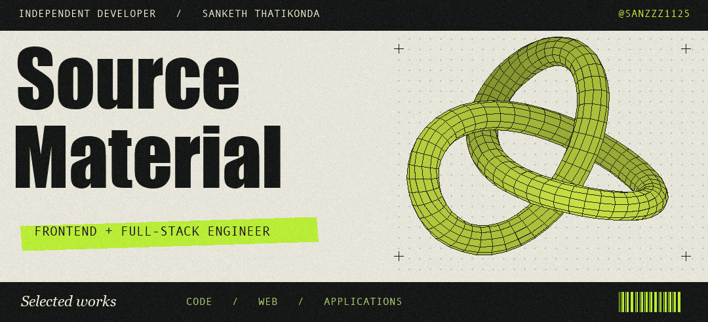
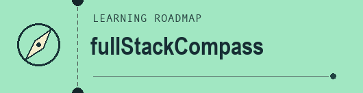
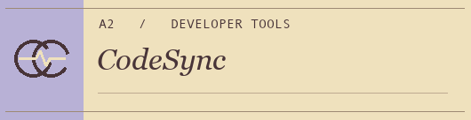
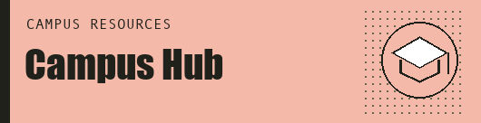
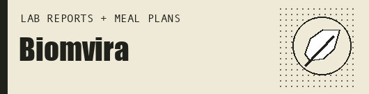
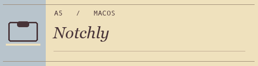
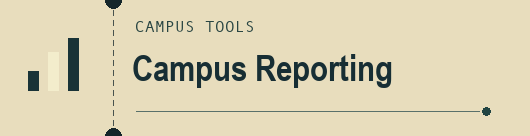

<a href="https://sanketh.live/"><picture><source media="(prefers-reduced-motion: reduce)" srcset="./assets/cover.png"></picture></a>

### Project index

 

 

 

**Languages** · JavaScript · Python · TypeScript · Java · Swift · HTML

[Portfolio](https://sanketh.live/) · [FullStackCompass demo](https://www.fullstackcompass.in/) · [Campus Hub demo](https://sanzzz1125.github.io/campus-hub/) · [Biomvira demo](https://biomvira.vercel.app/) · [All repositories](https://github.com/Sanzzz1125?tab=repositories)
