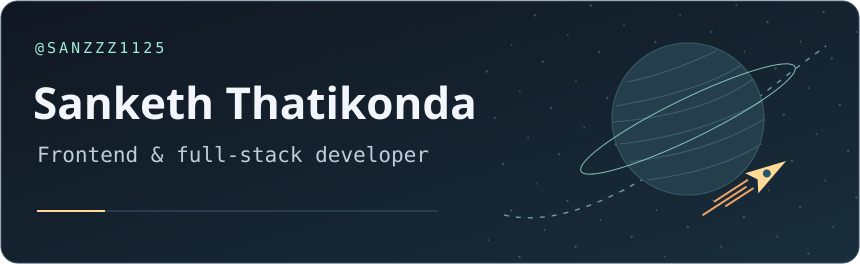
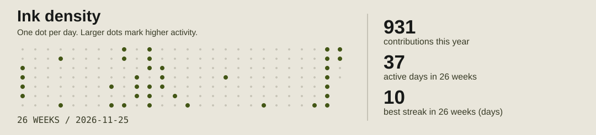

[Portfolio](https://sanketh.live/) · [All repositories](https://github.com/Sanzzz1125?tab=repositories)

I build web apps and developer tools. My projects span full-stack learning, campus tools, nutrition and macOS.

### Selected projects

| Project | Explore |
| --- | --- |
| **fullStackCompass** · A guide to learning full-stack development | [Live site](https://www.fullstackcompass.in/) · [Code](https://github.com/Sanzzz1125/fullStackCompass) |
| **Campus Hub** · A hub for campus resources | [Live site](https://sanzzz1125.github.io/campus-hub/) · [Code](https://github.com/Sanzzz1125/campus-hub) |
| **CodeSync** | [Code](https://github.com/Sanzzz1125/CodeSync) |
| **Nutrilens** | [Code](https://github.com/Sanzzz1125/Nutrilens) |
| **Notchly** | [Code](https://github.com/Sanzzz1125/Notchly) |

**Languages** · JavaScript · TypeScript · Python · Java · Swift

### Contribution flight

